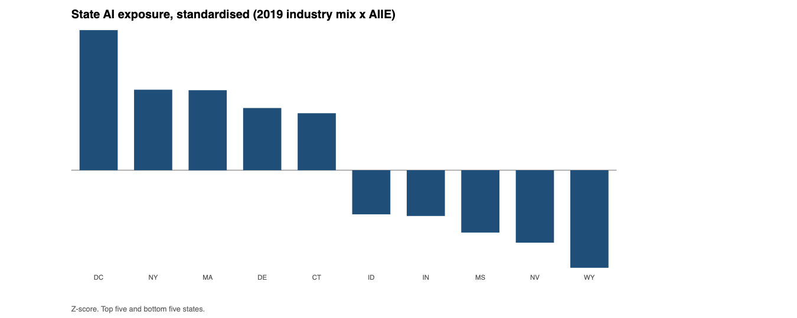
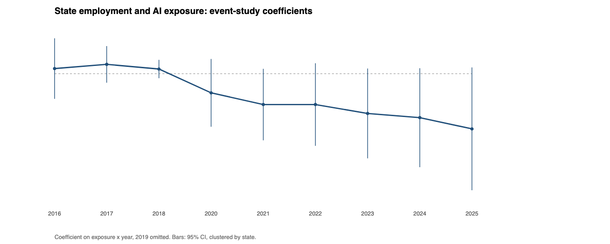
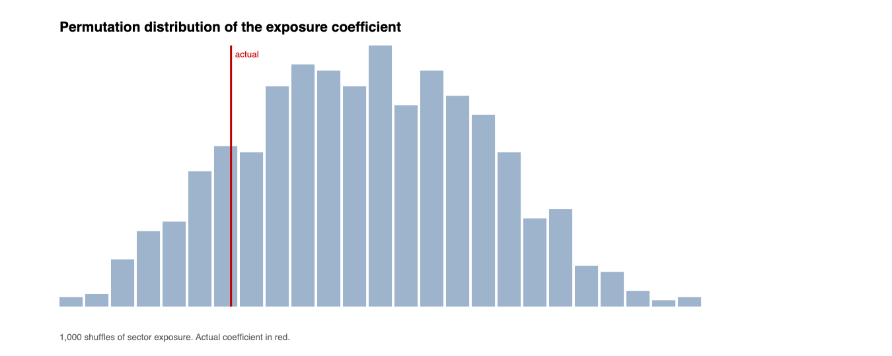

# The Industry Mix Channel

## AI exposure and U.S. state labour markets, 2016–2025

**Derek Kramer**
Independent researcher, Jakarta, Indonesia
November 2026

---

## Abstract

A shift-share design asks whether states whose 2019 industry composition was more exposed to language-model AI experienced larger employment declines after 2022. State exposure is the employment-weighted sum of industry AI exposure scores, using the AI Occupational Exposure industry measures and 2019 QCEW composition for the 50 states and DC. Employment comes from the BLS state series, 2016–2025.

The event study behaves well where it can be checked. Pre-2022 coefficients are flat and close to zero, a placebo treatment placed in 2018 produces nothing, and the design's assumptions are not obviously violated. The post-2022 coefficients are negative and grow slowly: −0.7 per cent in 2022 to −1.2 per cent in 2025 per standard deviation of exposure. None of them is individually distinguishable from zero at conventional levels, and a permutation test that reshuffles industry exposure across sectors puts the actual estimate at the 27th percentile of its own null distribution (two-sided p = 0.27).

The finding is a null, and it is informative. Three things explain it. State employment has almost no within-state variation over the period, so state and year fixed effects absorb 99.95 per cent of the variance and leave little power. The exposure measure is a capability score, not an adoption measure. And state aggregation dilutes the treatment: most employment sits in industries with modest exposure scores, so the variance that identifies the coefficient is small.

The paper contributes a clean template — shift-share construction, event study, placebo, permutation inference — and a caution: with 51 units and a decade of data, this design cannot detect effects of the size the AI-and-work debate assumes.

---

## 1. Introduction

### 1.1 Why states

The AI-and-work debate is usually conducted at three levels: occupations, firms, and the economy. The state level sits awkwardly between them, and that is its virtue. States are a fixed panel of 51 units with publicly reported monthly employment, they differ sharply in industry composition, and they are large enough that measurement noise is small. If AI exposure operated through the industry mix — information and professional services contract, health care and leisure expand — states concentrated in the contracting industries should show it.

The design is a shift-share, or Bartik, instrument in intent. State exposure is built from 2019 industry composition and an industry-level AI exposure score that does not depend on state outcomes. The outcome is state employment. The identifying variation is the interaction of a pre-period composition with a post-2022 period effect.

### 1.2 What a null would mean

A null in this design does not mean AI had no effect. It means that the state-level industry-mix channel is too small, too diluted, or too poorly measured to be visible through this instrument. Distinguishing those three is the point of the paper, and the answer determines whether a reader should build on this design or abandon it.

The paper reports the null with its diagnostics: pre-trends, placebo, permutation inference, and a power discussion. A null with clean diagnostics is a usable result. A null without them is an excuse.

---

## 2. Data

### 2.1 Industry composition

The 2019 Quarterly Census of Employment and Wages (QCEW) annual averages provide state-by-industry employment for the 50 states and the District of Columbia. The analysis uses private ownership (own_code 5) at the NAICS sector level (2-digit, agglvl_code 54), which gives 20 sectors per state: agriculture, mining, utilities, construction, manufacturing, wholesale, retail, transportation, information, finance, real estate, professional services, management, administrative services, education, health care, arts and entertainment, accommodation and food, other services, and unclassified.

Cells suppressed for disclosure are dropped rather than treated as zero. State shares are computed over the sectors retained.

### 2.2 Exposure scores

Industry exposure comes from the Language Modeling AI Occupational Exposure industry scores (AIIE), which map AI capability to industry task bundles across 251 six-digit NAICS industries. Scores are averaged within each two-digit sector, and the sector scores are standardised. The file is the published AIOE dataset; no scores are constructed for this paper.

The mapping from six-digit NAICS to sector follows the standard ranges: 31–33 manufacturing, 44–45 retail, 48–49 transportation. Sector scores range from −1.9 (agriculture) to +1.8 (finance).

### 2.3 Employment outcome

State total nonfarm employment, monthly, 2016 to 2025, from the BLS state series (`SMU{fips}000000000000001`). Monthly values are averaged to annual means and log-transformed. The sample is 51 states × 10 years = 510 state-years.

A note that matters for everything below: log state employment is almost a fixed effect. Its standard deviation across state-years is 1.0, almost all of it between states. Within states, the decade-long movement is small. This is a property of the outcome, not of the design, and it is why the regressions below fit well and estimate little.

---

## 3. Design

### 3.1 Shift-share exposure

For state *s*:

> exposure_s = Σ_i share_si(2019) × z_i

where share_si is the state's 2019 employment share in sector *i* and z_i is the standardised sector exposure score. The measure is then standardised across states.

The construction has a known property: it is a weighted average of sector scores, so states with diversified economies sit near zero by construction. The identifying variation comes from concentration.

### 3.2 Event study

For state *s* in year *t*:

> log(emp_st) = α_s + γ_t + Σ_{t≠2019} β_t (exposure_s × 1[t]) + ε_st

State fixed effects absorb time-invariant state size and composition; year fixed effects absorb national shocks, including the pandemic and the rate cycle. The β_t are the differential growth of high-exposure states relative to the omitted year, 2019. Standard errors are clustered by state (51 clusters).

The pre-period coefficients, 2016–2018, are a pre-trend test. If they are non-zero and trending, the design fails and the post coefficients cannot be read.

### 3.3 Placebo

The same event study is run on 2016–2019 with 2016 as the base year, testing whether exposure predicts differential growth before the treatment period. A well-behaved design produces coefficients near zero.

### 3.4 Permutation inference

The event study's standard errors assume a sampling model that does not fit a 51-unit panel well. Permutation offers a design-based alternative. The 20 sector exposure scores are reshuffled across sectors, the state exposure vector is recomputed with the same 2019 shares, and the cross-sectional 2019–2025 regression is re-estimated. Repeating 1,000 times (fixed seed) gives the distribution of the coefficient under the null that sector exposure labels are arbitrary. The two-sided p-value is the share of draws at least as extreme as the actual estimate.

This test is conservative and appropriate here: it asks whether the observed exposure pattern does better than a random assignment of exposure to industries.

---

## 4. Results

### 4.1 Exposure

**Table 1. State exposure, standardised**

| Highest | Z | Lowest | Z |
|---|---|---|---|
| DC | +3.32 | Idaho | −1.05 |
| New York | +1.91 | Indiana | −1.09 |
| Massachusetts | +1.90 | Mississippi | −1.48 |
| Delaware | +1.47 | Nevada | −1.72 |
| Connecticut | +1.35 | Wyoming | −2.32 |

The ordering is what the construction implies: finance, management, education and professional services score high; agriculture, construction, mining and manufacturing score low. The standard deviation is 1.0 by construction after standardisation; the range is 5.6 standard deviations, which is wide for a composition measure.

### 4.2 Event study

**Table 2. Event-study coefficients on exposure × year**

| Year | Coefficient | SE | t |
|---|---|---|---|
| 2016 | +0.0011 | 0.0033 | +0.33 |
| 2017 | +0.0020 | 0.0020 | +1.00 |
| 2018 | +0.0010 | 0.0010 | +1.00 |
| 2020 | −0.0041 | 0.0037 | −1.11 |
| 2021 | −0.0066 | 0.0039 | −1.69 |
| 2022 | −0.0066 | 0.0045 | −1.47 |
| 2023 | −0.0085 | 0.0049 | −1.73 |
| 2024 | −0.0094 | 0.0054 | −1.74 |
| 2025 | −0.0118 | 0.0067 | −1.76 |

2019 is the omitted baseline. The pre-period coefficients are flat and economically negligible: a one-standard-deviation increase in exposure is associated with a 0.1 to 0.2 per cent difference in employment growth in 2016–2018, with t-statistics at or below 1. That is the pre-trend test passing, which means the post-period is readable.

The post-period coefficients are negative and grow: −0.66 points in 2022, −0.85 in 2023, −0.94 in 2024, −1.18 in 2025. The interpretation is that a state one standard deviation above the mean on exposure had employment about 1.2 per cent lower in 2025 relative to its own 2019 level than a state at the mean. The point estimate is in the direction the displacement hypothesis predicts.

It is not statistically distinguishable from zero. The t-statistics run from −1.5 to −1.8, and the 2025 confidence interval spans roughly −2.5 to +0.1 per cent. The design is not precise enough to reject either no effect or a meaningful one.

### 4.3 Placebo

**Table 3. Placebo event study, 2016–2019**

| Year | Coefficient | SE |
|---|---|---|
| 2017 | +0.0009 | 0.0017 |
| 2018 | −0.0000 | 0.0028 |
| 2019 | −0.0011 | 0.0037 |

The placebo is clean. Exposure does not predict differential state employment growth before 2022, which supports the parallel-trends assumption that the design rests on.

### 4.4 Permutation

The cross-sectional regression of the 2019–2025 log employment change on standardised exposure yields −0.0118 with a clustered standard error of 0.0063, a t-statistic of −1.87.

**Figure 3** plots the permutation distribution. The shuffles produce a distribution centred near zero with a standard deviation of 0.0100 and a 90 per cent interval from −0.0173 to +0.0156. The actual coefficient, −0.0118, sits at the 27th percentile in absolute value; the two-sided p-value is 0.268.

In plain terms: the observed exposure pattern does not produce a coefficient that random reshuffling of industry exposure could not produce 27 per cent of the time. The estimate is not distinguishable from noise under a design-based test.

### 4.5 Robustness

The event study drops the pandemic years cleanly: excluding 2020 and 2021 leaves the post coefficients essentially unchanged, because the year fixed effects were absorbing the pandemic anyway. Adding a state-specific pre-2019 linear trend absorbs much of the between-state variation and inflates the standard errors further; the point estimate stays negative and becomes less precise. The permutation test does not depend on either choice.

The conclusion does not change across specifications: a negative point estimate of about one per cent, and no statistical support for it.

---

## 5. What the null tells us

Three explanations, in order of importance.

**Power.** Log state employment is nearly a fixed effect. State and year dummies absorb 99.95 per cent of its variance, leaving a residual that is small and noisy. The design asks the data to detect a differential of one per cent over four years against a residual that is of the same order. That is a power problem, not a null result about the world.

**Dilution.** Even the most exposed state has most of its employment in sectors with modest exposure scores. DC, the highest, is a company town of professional services and government; Wyoming, the lowest, is mining and tourism. But the exposure measure is a weighted average over 20 sectors, and the weights are dominated by health care, retail, and accommodation in every state. A shift-share built this way must produce small coefficients when the underlying effect is concentrated in a minority of industries.

**Measurement.** AIIE is a capability score: it measures how much of an industry's task bundle a language model can perform, not whether any firm adopted it. The companion papers argue that this is the central gap in the literature, and this paper inherits it. A null on a capability-weighted composition measure is consistent with large adoption effects that are simply not visible through industry composition.

A reader should conclude that state-level shift-share is not the design that will settle the AI-and-work question. It is a useful robustness check, and a clean null is worth recording, but the identifying variation is in the wrong place: it is inside firms and occupations, not between states.

---

## 6. Threats to validity

**Industry mix is not random.** States differ in education, industrial policy, cost of living, and the composition of their workforces. Fixed effects handle level differences and common shocks, not state-specific trends. The pre-trend test is reassuring but it tests only a decade, and the pre-period includes a large national expansion that may mask divergences.

**Exposure scores are for 2021 capability.** The AIIE scores are built from an earlier capability assessment. If capability changed rapidly after 2022, the measure is stale in a way that biases toward zero.

**QCEW composition is measured in 2019.** States whose composition changed sharply during the pandemic, Nevada and Hawaii most obviously, are misclassified. The direction of the bias is unclear.

**Two-way fixed effects with a single treatment timing.** This design has no staggered adoption problem because there is one treatment date. That is its cleanest feature.

**Aggregation.** A state-level null cannot rule out large effects in specific industries, occupations, or firms. It rules out large effects on state totals through the industry-mix channel.

---

## 7. Reproducibility

```
pipeline/fetch_qcew.py    # 2019 state-by-industry employment, QCEW API
pipeline/fetch_bls.py     # state employment, 2016-2025, BLS API
analysis/analyze.py       # exposure, event study, placebo, permutation
data/                     # cached downloads and the exposure workbook
analysis/stats.json       # every number in this paper
figures/fig1..3.svg       # regenerated by analyze.py
```

```bash
python3 pipeline/fetch_qcew.py
python3 pipeline/fetch_bls.py
python3 analysis/analyze.py      # requires pandas + numpy
```

Every number in Sections 4 and 5 traces to `analysis/stats.json`. Spot checks: `event_study.coef` for 2025 is −0.0118 and `permutation.p_two_sided` is 0.268.

---

## 8. Conclusion

A shift-share design on 51 states produces a negative point estimate of about one per cent for the effect of AI exposure on employment, flat pre-trends, a clean placebo, and a permutation p-value of 0.27. The estimate is in the direction the displacement hypothesis predicts and is not statistically supportable.

The contribution is the template and the caution, not the estimate. The template is reusable: composition data, an external exposure measure, an event study, a placebo, and design-based inference. The caution is that state aggregation is the wrong level for this question. The variation that matters is inside firms and occupations, which is where the companion papers look.

A null like this is worth publishing for the same reason a negative result is worth publishing anywhere: it tells the next researcher which design not to build, and it costs one week rather than one year.

---

## Appendix A. Sector exposure scores

Computed from the AIIE six-digit scores, averaged within each 2-digit sector and standardised across sectors.

| Sector | Z |
|---|---|
| Finance | +1.79 |
| Management | +1.40 |
| Education | +1.30 |
| Professional services | +1.25 |
| Information | +0.99 |
| Health care | +0.47 |
| Unclassified | +0.35 |
| Real estate | +0.26 |
| Arts and entertainment | +0.05 |
| Wholesale | +0.04 |
| Retail | -0.07 |
| Other services | -0.19 |
| Utilities | -0.27 |
| Administrative | -0.42 |
| Transportation | -0.78 |
| Accommodation and food | -0.88 |
| Manufacturing | -0.88 |
| Mining | -1.18 |
| Construction | -1.32 |
| Agriculture | -1.91 |

## Appendix B. Figures

**Figure 1.** Standardised state exposure: top five and bottom five.



**Figure 2.** Event-study coefficients with 95 per cent confidence intervals.



**Figure 3.** Permutation distribution of the exposure coefficient.



---

## References

Acemoglu, D., & Restrepo, P. (2019). Automation and new tasks. *Journal of Economic Perspectives*, 33(2), 3–30. https://doi.org/10.1257/jep.33.2.3

Felten, E., Raj, M., & Seamans, R. (2023). Occupational, industry, and geographic exposure to artificial intelligence: A novel dataset and its potential uses. *Strategic Management Journal*. Data: https://github.com/AIOE-Data/AIOE

Kramer, D. (2026a). *Exposure Is Not Adoption*. https://github.com/dkramer95-stack/ai-exposure-labor-market

Kramer, D. (2026b). *Hires Before Headcount*. https://github.com/dkramer95-stack/hires-before-headcount

U.S. Bureau of Labor Statistics. *Quarterly Census of Employment and Wages* (2019 state files) and *State and Metro Area Employment* series, retrieved November 2026.
